# Отчёт о выполнении Лабораторной работы 6: Введение в FastAPI

**Автор:** Литвинов А.О., группа КБ-241

## Содержание
- [Задание 2. Параметры пути и query-параметры](#задание-2-параметры-пути-и-query-параметры)
- [Задание 3. Модель Pydantic и POST-запрос](#задание-3-модель-pydantic-и-post-запрос)
- [Задание 4. Организация кода: вынос маршрутов](#задание-4-организация-кода-вынос-маршрутов)
- [Задание 5. Конфигурация через Pydantic Settings](#задание-5-конфигурация-через-pydantic-settings)
- [Задание 6. Обработка ошибок и документация](#задание-6-обработка-ошибок-и-документация)
- [Задание 7. Самостоятельная работа (PUT и уникальность)](#задание-7-самостоятельная-работа-put-и-уникальность)
- [Задание 8. Логирование](#задание-8-логирование)
- [Вывод](#вывод)

## Задание 2. Параметры пути и query-параметры

Проверка работы эндпоинта `/items/42?q=test`. Сервер корректно возвращает переданные параметры в формате JSON (<a href="#fig1">Рисунок 1</a>).

  <a href="images/2_json.png" target="_blank">
    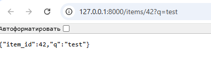
  </a>

Рисунок 1 - Проверка ответа JSON

Тестирование эндпоинта через встроенную интерактивную документацию Swagger UI (кнопка "Try it out") (<a href="#fig2">Рисунок 2</a>).

  <a href="images/2_try_it_out.png" target="_blank">
    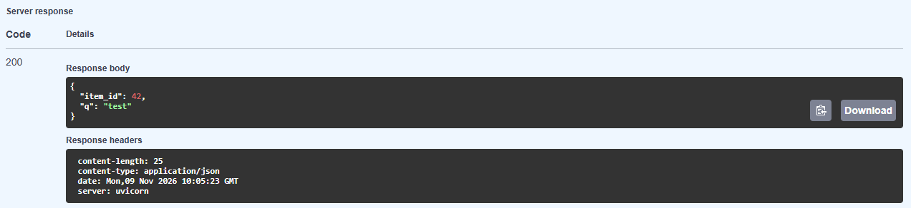
  </a>

Рисунок 2 - Тестирование через /docs

## Задание 3. Модель Pydantic и POST-запрос

Тестирование POST-запроса для создания товара через Swagger UI (<a href="#fig3">Рисунок 3</a>).

  <a href="images/3_try_it_out.png" target="_blank">
    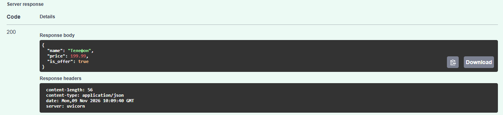
  </a>

Рисунок 3 - Выполнение POST-запроса

## Задание 4. Организация кода: вынос маршрутов

Проверка доступности эндпоинтов после переноса маршрутов в отдельный роутер (тег "items" в документации) (<a href="#fig4">Рисунок 4</a>).

  <a href="images/4_items.png" target="_blank">
    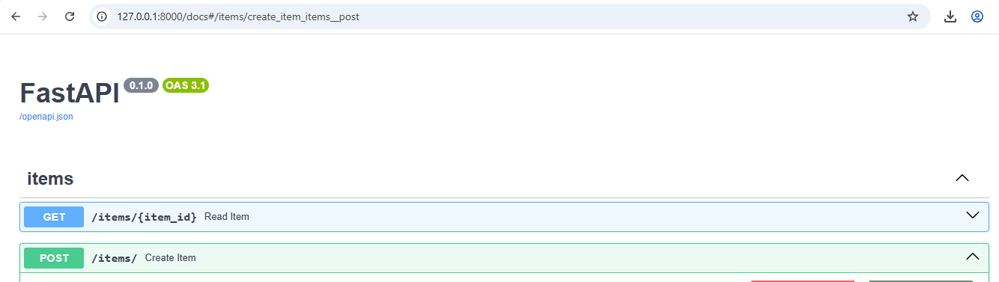
  </a>

Рисунок 4 - Структура маршрутов в /docs

## Задание 5. Конфигурация через Pydantic Settings

Проверка эндпоинта `/info`. Значение `items_per_page` успешно подтянулось из `.env` файла (равно 20) (<a href="#fig5">Рисунок 5</a>).

  <a href="images/5_info.png" target="_blank">
    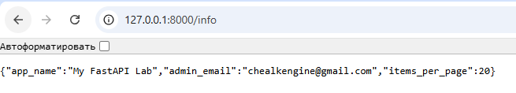
  </a>

Рисунок 5 - Вывод настроек приложения

## Задание 6. Обработка ошибок и документация

Обновленный интерфейс Swagger UI с метаданными (версия, контакт, описание) (<a href="#fig6">Рисунок 6</a>).

  <a href="images/6_info.png" target="_blank">
    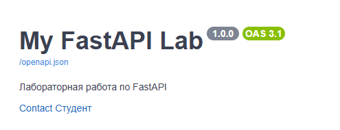
  </a>

Рисунок 6 - Обновленная документация

Проверка обработки ошибок (<a href="#fig7">Рисунок 7</a>, <a href="#fig8">Рисунок 8</a>, <a href="#fig9">Рисунок 9</a>).

  <a href="images/6_error_1.png" target="_blank">
    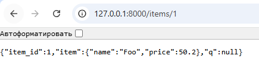
  </a>

Рисунок 7 - Запрос существующего ID

  <a href="images/6_error_2.png" target="_blank">
    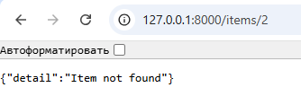
  </a>

Рисунок 8 - Запрос несуществующего ID

  <a href="images/6_error_3.png" target="_blank">
    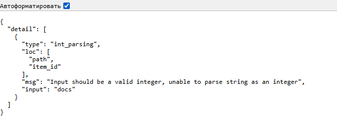
  </a>

Рисунок 9 - Ответ сервера при передаче неверного типа данных

## Задание 7. Самостоятельная работа (PUT и уникальность)

Успешное обновление товара через метод PUT (<a href="#fig10">Рисунок 10</a>).

  <a href="images/7_200.png" target="_blank">
    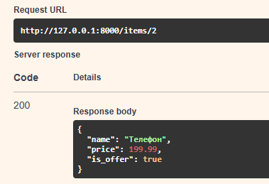
  </a>

Рисунок 10 - Успешное обновление (код 200)

Обработка ошибки при попытке обновить несуществующий товар (<a href="#fig11">Рисунок 11</a>).

  <a href="images/7_404.png" target="_blank">
    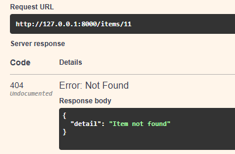
  </a>

Рисунок 11 - Ошибка: товар не найден (код 404)

Проверка валидации уникальности имени (попытка задать имя, которое уже занято). Валидация отрабатывает корректно (<a href="#fig12">Рисунок 12</a>, <a href="#fig13">Рисунок 13</a>).

  <a href="images/7_409_0.png" target="_blank">
    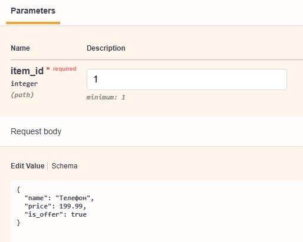
  </a>

Рисунок 12 - Ошибка валидации (код 409)

  <a href="images/7_409_1.png" target="_blank">
    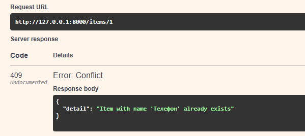
  </a>

Рисунок 13 - Детали ошибки 409

## Задание 8. Логирование

В консоль выводится информация о запросах и возникающих предупреждениях с указанием времени и уровня логирования (<a href="#fig14">Рисунок 14</a>, <a href="#fig15">Рисунок 15</a>).

  <a href="images/8_0.png" target="_blank">
    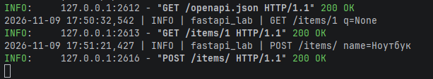
  </a>

Рисунок 14 - Вывод логов в консоль

  <a href="images/8_1.png" target="_blank">
    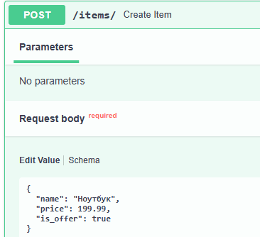
  </a>

Рисунок 15 - Логирование предупреждений

## Вывод

В ходе выполнения лабораторной работы были изучены основы разработки REST API на фреймворке FastAPI. 

Освоено управление зависимостями с помощью `uv`, настройка маршрутизации (параметры пути и query), валидация данных через Pydantic и обработка POST/PUT запросов. Реализована модульная структура с использованием `APIRouter`, конфигурация через `pydantic-settings`, обработка ошибок (`HTTPException`) и кастомное логирование.

В результате создано работающее FastAPI-приложение с автоматической документацией Swagger UI, протестированы все эндпоинты и оформлен отчет.